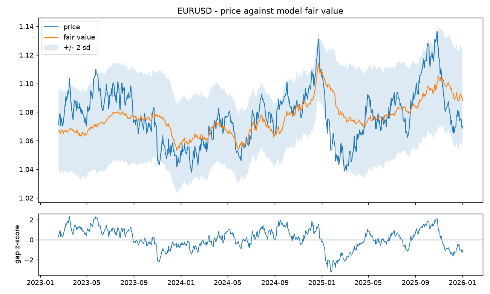

# FX Macro Model

A multi-factor FX research toolkit in Python. It estimates a macro **fair value** for major currency
pairs and metals, turns it into a **per-currency score against a basket of the other majors** for
20-day and 60-day horizons, classifies volatility **regimes** with a Markov-switching model, scans
for **cointegrated pairs** (statistical arbitrage) and folds in **options-market** inputs
(risk reversals from an implied smile).

Stack: Python, pandas, NumPy, statsmodels, SciPy, Matplotlib.

> The repository ships **no market data and no data-vendor code**. It runs out of the box on a
> synthetic market with a known data-generating process, and reads your own data from CSV files.
> Every number in this README comes from that synthetic market, so it demonstrates that the
> machinery works, not that it makes money.



## Setup

Requires Python 3.10 or newer.

```bash
git clone https://github.com/tudosevlad1234/fx-macro-model.git
cd fx-macro-model
python -m venv .venv
source .venv/bin/activate        # Windows: .venv\Scripts\activate
pip install -e ".[dev]"
```

Check the install (about a minute):

```bash
pytest
```

## Run it

```bash
python -m fxmacro demo --out output
```

This runs the full pipeline on synthetic data (about a minute) and writes to `output/`:

| File | Contents |
| --- | --- |
| `report.md` | currency scores, fair values, pair scores, regimes, option smiles, stat-arb table |
| `currency_scores.csv`, `pair_scores.csv`, `fair_value.csv` | the same tables as CSV |
| `currency_scores.png`, `charts/<PAIR>.png` | score chart and price-vs-fair-value charts |
| `summary.json` | regimes and expected daily move per pair |

Or from Python:

```python
from fxmacro import run
from fxmacro.pipeline import currency_table
from fxmacro.synthetic import generate

result = run(generate(seed=7), instruments=["EURUSD", "USDJPY", "AUDUSD"], include_stat_arb=False)
print(result["fair_value"])
print(currency_table(result["currency_scores"]))
```

## Use your own data

```bash
python -m fxmacro export-template --out data      # writes example CSVs in the expected format
python -m fxmacro run --data data --out output
```

| File | Columns |
| --- | --- |
| `prices.csv` | `date` plus one column of daily closes per pair, e.g. `EURUSD`, `USDJPY`, `XAUUSD` |
| `yields.csv` | `date, ccy, tenor, value` with tenors `ON`, `Y1`, `Y2`, `Y5`, `Y10`, and `REAL10` for US real yields |
| `macro.csv` | `date, ccy, field, value` with fields `CPI` (index level), `UNEMP`, `TRADE` |
| `market.csv` | `date` plus `VIX`, `SPX`, `COPPER`, `WTI` (any subset) |
| `events.csv` (optional) | `date, ccy, impact, forecast, actual` and optionally `sd` - economic-calendar releases |
| `options.csv` (optional) | `pair, expiry, strike, call, put` - option prices on the pair (or on its inverse for USDJPY, USDCHF, USDCAD) |

Currencies are `USD EUR GBP JPY CHF AUD CAD NZD`. Date each macro value at the **end of the period it
describes** (September CPI is dated 30 September). The model then adds typical publication delays
(CPI 20 days, unemployment 35, trade 45) so it never uses a number before it would have been
released. Data dated at the start of the month would let the model see figures about a month early.

## What is in the model

| Module | What it does |
| --- | --- |
| `fair_value.py` | Rolling exponentially weighted least squares on rate differentials and market drivers (VIX, SPX, copper, WTI), shrunk toward long-run betas, with a floor on the rate coefficient, HAC t-statistic driver pruning, an error-correction model, Engle-Granger and Lo-MacKinlay variance-ratio tests, a PPP anchor, and a rebuild of crosses from USD legs when that fits better |
| `currency_score.py` | Each currency's move against the equal-weighted basket of the other majors, scored from inflation, unemployment and trade momentum, data surprises, and rate momentum and level - each measured relative to the basket |
| `pair_score.py` | Pair score from rate momentum, fair-value momentum (orthogonalised to rate momentum), fair-value gap, carry, macro, surprises and option skew |
| `scoring.py` | Walk-forward information coefficients, weights shrunk toward priors, rolling calibration of score to expected move, probability of an up move, and a reliability check of those probabilities |
| `regime.py` | Two-state Gaussian Markov switching (Hamilton filter, backward smoother, multi-start EM); reports "undetermined" when the two states are not meaningfully different |
| `statarb.py` | Cointegration scan with a train/test split, a filter for mechanical pairs (triangular identities), half-life and cost screens, a phase-randomised null test, and a walk-forward backtest with trailing hedge ratio |
| `smile.py`, `options.py` | Black-76 implied volatility, implied forward from put-call parity, 25-delta risk reversal and butterfly, cross risk reversals from USD legs |
| `volatility.py` | EWMA volatility and expected daily move in pips |

### How a score is built

1. Every component is expressed relative to the other currencies and squashed into (-1, 1).
2. Each component's predictive power is measured by a rolling correlation with the future
   move, **shifted by the horizon** so no future return leaks into the weights.
3. Weights are `0.7 x prior + 0.3 x measured positive IC`, so a noisy estimate cannot dominate.
4. The composite score is regressed on subsequent returns in a rolling window to get an expected
   move and a probability of an up move. If that slope is zero or negative (the score has not
   predicted moves recently) the expected move is set to zero and the probability to 50% - the
   signal is never flipped. Probabilities are marked *calibrated* only when the score has skill and
   the bucketed predicted and realised frequencies agree within 5 percentage points over at least
   500 observations.

### Example output (synthetic data)

```
| currency | score | 20d_verdict | 20d_p_up_pct | 20d_calibrated | 60d_verdict | 60d_p_up_pct |
|:---------|------:|:------------|-------------:|:---------------|:------------|-------------:|
| AUD      |  0.27 | Neutral     |        50.00 | False          | Neutral     |        50.00 |
| NZD      |  0.07 | Neutral     |        51.32 | True           | Neutral     |        52.24 |
| EUR      | -0.42 | Neutral     |        44.77 | True           | Bearish     |        39.08 |
| ...      |       |             |              |                |             |              |
```

Most probabilities sit at 50%: in the synthetic market the inflation, unemployment, trade and
surprise series are generated independently of exchange rates, so the scores rightly find little
to work with.

The statistical-arbitrage scan examines 253 pairs and keeps four, all among the AUD/NZD-linked
legs that the synthetic data deliberately drives with a shared commodity trend. Pairs that merely
restate a triangular identity (for example EURUSD/EURJPY) are rejected as mechanical. In the
out-of-sample part of the history (the last 35%, about five years) the four pairs trade 19 to 21
times each, with Sharpe ratios between 0.97 and 1.35 after the per-trade cost.

## Tests

81 tests cover the numerical core against independent references:

- the Markov-switching likelihood matches `statsmodels.MarkovRegression`
- the smile fit recovers a known 25-delta risk reversal to within 0.15 volatility points
- cointegration tests accept a planted cointegrated pair and reject independent random walks
- information coefficients and rolling fair values are unchanged when future data is removed
- the stat-arb simulator charges costs on entry and exit, exits when the spread overshoots the
  mean, and waits after a stop-loss before re-entering
- weights sum to one, scores stay bounded, CSV inputs round-trip, the CLI runs end to end

```bash
pytest
ruff check .
```

## Limitations

- **Synthetic demo only.** Results on real data will look different, and no claim is made here
  about live performance.
- The set of drivers kept in each fair-value regression is chosen on the most recent 1000 days.
  The long-run coefficients used as the shrinkage anchor are refreshed every 63 days from trailing
  data, but historical fair values are still not a strict out-of-sample backtest. The latest
  reading is unaffected.
- Option inputs need a chain of call and put prices covering roughly the 25-delta wings; sparse
  chains are skipped rather than extrapolated. A cross without its own chain gets its risk reversal
  as the sum of its USD legs' risk reversals, which is only an approximation.
- Statistical-arbitrage costs use a flat per-pair cost in pips, not live spreads or financing.
- This is research code, not investment advice.

## License

MIT
